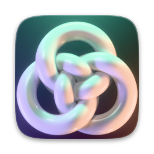
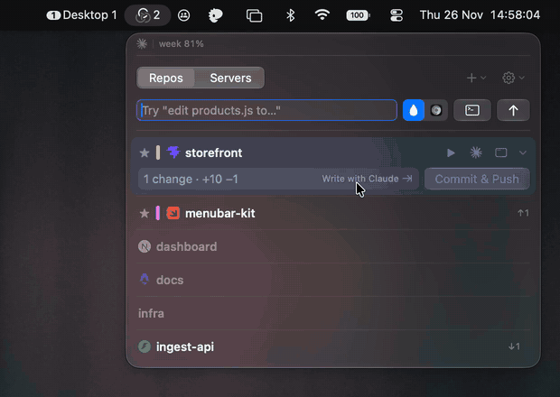

<p align="center"></p>

<h1 align="center">Bridge</h1>

<p align="center">Your repositories, dev servers and coding agents, one click away in the macOS menu bar.</p>

<p align="center"><a href="LICENSE"></a></p>

<p align="center"></p>

## What it does

**Repos.** Every git repository you work in, with what's going on in each: local changes, commits to push or pull, a running dev server, an agent session. Commit, pull and push from the panel, have your coding agent write the commit message, start the project's dev server in the background, or open the agent in your terminal. A main window adds changes, history and diffs.

**Servers.** Everything listening on a local port, with CPU and memory: dev servers, databases, Docker containers. Open, restart or stop them, and keep favorites you can start again later.

Bridge works with the tools you already use:

- **Coding agents:** Claude Code, Codex, Cursor CLI, Gemini CLI, GitHub Copilot CLI, OpenCode, or none.
- **Terminals:** Terminal, iTerm, Ghostty, Warp, WezTerm, kitty, Rex.
- **Git hosts:** GitHub (through `gh`) and GitLab (through `glab`) for publishing, cloning and pull or merge requests.
- **Editors:** VS Code, Cursor, Windsurf, Zed, Xcode, Sublime Text, Nova, JetBrains IDEs and more.

It shells out to `git` and your agent's CLI, so your own config, keys, hooks and logins apply.

## Install

Download Bridge from [bridge.olikab.com](https://bridge.olikab.com) (or the latest `Bridge-<version>.dmg` from [Releases](../../releases)), open it and drag Bridge to Applications. Bridge updates itself: when a new version is out, the panel offers Update.

Requires macOS 14 or later, on Apple Silicon or Intel.

Bridge sends one anonymous ping a day so we can count how many copies are in use: a random install id, Bridge's version, the macOS version and whether the Mac is Apple Silicon or Intel. Nothing about you, your repositories or your tools, and no IP address is stored. Turn it off in Settings › Send anonymous usage count. The endpoint's code is in [`telemetry/`](telemetry).

## Build from source

```sh
swift build                 # quick compile check
./build.sh --install        # universal release build, installed to /Applications and started
```

No dependencies beyond Xcode's command line tools. `build.sh` signs with your Apple Development certificate when you have one (ad hoc otherwise; then macOS asks for folder access again after each build).

## Claude Code usage left

With Claude Code, the top line of the panel can show how much of your plan's 5-hour and weekly limits is left. Claude Code has no command that prints this, but it hands the limits to your [status line](https://code.claude.com/docs/en/statusline) script, so the script saves them for Bridge. Add this to your status line script (it needs `jq`):

```sh
input=$(cat)
limits=$(echo "$input" | jq -c '.rate_limits // empty')
if [ -n "$limits" ] && [ "$limits" != "{}" ]; then
  tmp=$(mktemp "$HOME/.claude/.rate-limits.XXXXXX") && printf '%s' "$limits" > "$tmp" && mv "$tmp" "$HOME/.claude/rate-limits.json"
fi
```

The numbers are as fresh as your last Claude Code session. Without the file, Bridge leaves the usage out.

## Shortcuts

- ⌥⌘G opens Repos, ⌥⌘P opens Servers.
- In Repos: ↑/↓ selects, Return runs the prompt in the selected repository, Esc steps back, ⌘R fetches, ⌘N starts a new project, ⌘O adds a repository. Folders dropped from Finder are added.

## License

[MIT](LICENSE). The tool and framework logos in `Resources/Logos` are from [Simple Icons](https://simpleicons.org) (CC0); the trademarks belong to their owners.
